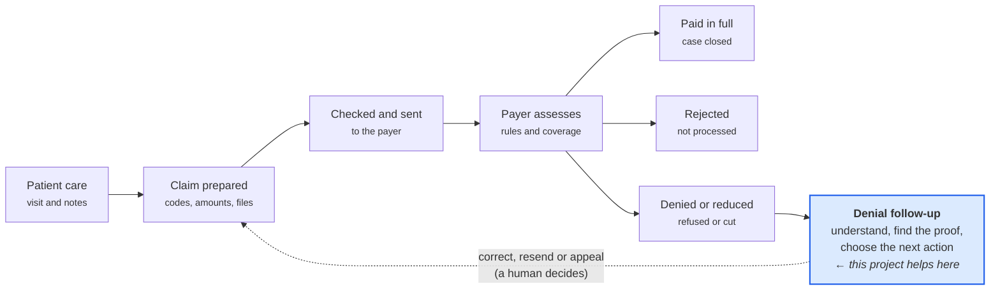
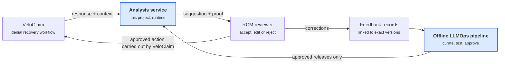
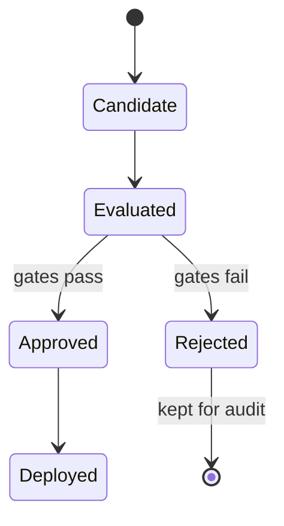

# LLMOps FrameWork — Insurance Denial Analysis and Recovery Assistant

> **Requirements specification (cahier des charges) — version 2.0, 14 October 2026**
> Status: proposed, for stakeholder review. Replaces version 1.1.

An AI assistant that reads an insurer's refusal to pay a medical bill, explains why it was refused, shows the proof, and suggests what a human reviewer should do next — plus the LLMOps process that tests, releases, monitors and safely improves it.

---

## Table of contents

0. [Document control](#0-document-control)
1. [The project in one page](#1-the-project-in-one-page)
2. [How healthcare insurance claims work](#2-how-healthcare-insurance-claims-work)
3. [What the payer answers, and why it is hard to read](#3-what-the-payer-answers-and-why-it-is-hard-to-read)
4. [VeloClaim and where this project fits](#4-veloclaim-and-where-this-project-fits)
5. [Three worked examples](#5-three-worked-examples)
6. [Problem, objectives and research question](#6-problem-objectives-and-research-question)
7. [Scope, users and boundaries](#7-scope-users-and-boundaries)
8. [Functional requirements](#8-functional-requirements)
9. [Data design and governance](#9-data-design-and-governance)
10. [Model research, evaluation and release gates](#10-model-research-evaluation-and-release-gates)
11. [Operations, monitoring and non-functional requirements](#11-operations-monitoring-and-non-functional-requirements)
12. [Implementation and delivery plan](#12-implementation-and-delivery-plan)
13. [Deliverables and acceptance](#13-deliverables-and-acceptance)
14. [Risks, assumptions and open decisions](#14-risks-assumptions-and-open-decisions)
15. [Glossary](#15-glossary)

---

## 0. Document control

| Item | Value |
| --- | --- |
| Project | LLMOps for insurance denial analysis and recovery assistance (VeloClaim-related academic project) |
| Document type | Requirements specification (cahier des charges) |
| Version | 2.0, replaces 1.1 of 14 October 2026 |
| Status | Proposed, for stakeholder review |
| Readers | Academic supervisors, sponsor, healthcare billing reviewers, product stakeholders, developers |
| Not yet fixed | Dataset sizes, numeric performance targets, compute, exact schedule (confirmed at inception) |

### How to read this document

| If you are… | Read first | Then |
| --- | --- | --- |
| New to insurance or VeloClaim | Section 1, then sections 2 to 5 | Section 6 |
| Supervisor or sponsor | Sections 1, 6, 7 | Sections 11, 13, 14 |
| Billing (RCM) reviewer | Sections 2 to 5, 8 | Section 9 (labels) |
| Developer | Section 1, then sections 8 to 14 | Glossary as needed |

**Conventions.** `FR` = functional requirement (what the system does). `NFR` = non-functional requirement (how well, how safely). **Must** = required for the first release; **Should** = expected unless a recorded reason prevents it; **May** = optional. Technical terms are explained in the [glossary](#15-glossary).

**Changes from 1.1.** One-page summary; from-zero explanation of claims and payer answers with diagrams; three worked examples instead of one; glossary; plain-language column for each requirement; list of open decisions. No requirement was removed.

---

## 1. The project in one page

We will build an AI assistant that reads an insurer's refusal to pay a medical bill, explains why it was refused, shows the proof, and suggests what a human reviewer should do next. Around it, we will build the engineering process (LLMOps) that tests, releases, monitors and safely improves that assistant.

**The problem in plain words.** When a clinic sends a bill to an insurer, the insurer sometimes refuses or reduces payment. Its answer is often a short code or a vague sentence such as *"supporting documentation missing"*. A billing employee must then work out what went wrong, find the evidence and decide what to do. This is slow, repetitive and error-prone. A general AI chatbot could help, but it may sound confident while inventing rules or recommending actions the evidence does not support.

**What the assistant does (first release).**

1. Reads the insurer's response and the related bill information.
2. Classifies the problem (missing document, coding error, coverage, prior approval, duplicate, late filing…).
3. Quotes the exact evidence it relies on.
4. Separates what the insurer actually said from what the assistant only suspects.
5. Suggests a next action, or says clearly *"I cannot tell; a human must check"*.
6. Lets a reviewer accept, edit or reject the suggestion, and records why.

**What it never does.** It does not change or resubmit a bill, contact an insurer, make medical decisions, or decide whether the insurer must pay. A human always decides.

**Why LLMOps matters here.** Every answer is linked to the exact model, prompt, data and reference documents that produced it. A new version goes live only if it passes agreed quality and safety checks, and it can be rolled back at any time.

**Research question.** How much do structured bill context, approved reference documents and reviewed human corrections improve classification and suggestions over a simple rule-based baseline, while keeping unsupported suggestions and running cost low?

**Deliverable.** A standalone academic demonstrator with a documented interface for later VeloClaim integration. The base AI model is not chosen in advance; MedGemma is one candidate among others. Indicative duration: 12 weeks.

---

## 2. How healthcare insurance claims work

A **claim** is a bill that a healthcare provider sends to an insurer, asking it to pay for care already given to a patient. Everything in this project starts from that bill and the insurer's answer to it.

**An everyday comparison.** Imagine an employee who eats at a restaurant on a business trip. The restaurant does not ask the employee to pay; it sends the bill to the employer. The employer checks that the meal was allowed, that the bill is complete, and that it was not already paid, then pays all of it, part of it, or nothing. Healthcare insurance works the same way, with the clinic as the restaurant, the insurer as the employer, and far stricter rules.

### 2.1 Who is involved

| Actor | Who they are | Role in this project |
| --- | --- | --- |
| Patient | The person who received care | Their data must be protected; they never use the system |
| Provider | Hospital, clinic or doctor who gave the care | Sends the claim and wants to be paid |
| Payer | Insurer, public scheme or other body that pays | Accepts, refuses or reduces payment |
| RCM team | The provider's billing staff (revenue cycle management) | Main users: they review the assistant's suggestions |
| VeloClaim | The software that prepares and follows up claims | Will host the assistant later (section 4) |

### 2.2 What a claim contains

A claim is a structured form, not a free letter. It typically holds:

- **Who:** patient identity, insurance policy number, provider identity.
- **What and when:** each service delivered, its date and its price. Each service is one *service line*; a claim can have many.
- **Why:** diagnosis codes (the medical reason) and procedure codes (what was done), taken from official code lists that depend on the country and payer.
- **Proof:** references to supporting documents such as clinical notes, lab results or an approval number.

### 2.3 The journey of a claim



Most claims are paid; the others come back rejected or denied, and someone must act. That follow-up step is where this project helps.

### 2.4 Two checks that happen before care

- **Eligibility:** is the patient actually covered by this payer for this kind of service on this date?
- **Prior authorization:** for some expensive or sensitive services, the payer must approve *before* the care is given and issues an approval reference.

Passing both checks does not guarantee payment: the claim can still be refused for other reasons. Rules differ by payer, service and contract.

### 2.5 Why refusals are costly

Each refused claim delays money the provider has earned and costs staff time to investigate. Messages are short and codes are cryptic, so staff reconstruct the reason by hand. Some refusals are never followed up and the money is lost. This project targets that investigation work. It gives no medical advice and does not decide whether the payer is right.

---

## 3. What the payer answers, and why it is hard to read

The payer's answer is usually a code plus a short message. It states a reason without always explaining the root cause. The assistant must keep the original wording and never assume more than the answer says.

### 3.1 Rejection, denial, partial payment

| Answer | What it means | Typical example | Typical fix |
| --- | --- | --- | --- |
| **Rejection** | Not accepted for processing: the payer never looked at the content | Invalid policy number, missing field, wrong format | Correct the data and send again |
| **Denial** | Assessed, and payment **refused** | Service not covered, no prior authorization, filed too late | Correct, provide evidence, appeal, or accept the loss |
| **Partial payment** | Assessed, and payment **reduced** | One service line refused; amount above agreed price | Check each line; act on refused or reduced ones |

Payers do not all use these words the same way. The system stores the payer's original status and message and treats the categories above as this project's working definitions.

### 3.2 Claim level versus service-line level

One claim can contain several services. The payer may pay three lines, refuse one and reduce another. An answer can apply to the whole claim or to specific lines. The assistant must always say which level each issue applies to.

### 3.3 How answers are coded

Answers arrive in structured electronic formats, often with standard reason codes. **As an illustration only**, in the United States:

- A **rejection** is usually returned as a technical acknowledgment of the submitted file.
- A **payment decision** is returned as an electronic remittance advice (X12 835). It explains each adjustment with a *Claim Adjustment Reason Code* (CARC, the main reason), optional *Remittance Advice Remark Codes* (RARC, extra detail), and a *group code* saying who bears the cost.
- In the FHIR standard, the equivalent information appears in a `ClaimResponse` or `ExplanationOfBenefit` resource.

Other countries and payers use other formats. This project assumes no single country; supported formats are confirmed at inception (section 14).

### 3.4 Common families of denial reasons (draft taxonomy)

| Category | Plain meaning | Example message |
| --- | --- | --- |
| Documentation | A required document is missing or insufficient | "Supporting documentation missing" |
| Coding | Diagnosis and procedure codes invalid or inconsistent | "Procedure inconsistent with diagnosis" |
| Eligibility and coverage | Patient not covered, or service not in the plan | "Coverage terminated before date of service" |
| Prior authorization | Advance approval missing, expired or mismatched | "Authorization number missing" |
| Duplicate | Same service already billed | "Duplicate claim or service" |
| Timely filing | Claim sent after the payer's deadline | "Time limit for filing has expired" |
| Pricing or contract | Amount above agreed rate, or bundled with another service | "Charge exceeds fee schedule" |
| Administrative data | Wrong patient, provider or policy details | "Patient ID invalid" |
| Unknown or other | Fits no category above | Vague or unrecognised code |

Example messages are illustrative wordings, not quotations from any payer. The taxonomy is versioned and refined with an RCM reviewer.

### 3.5 Stated reason is not root cause

*"Supporting documentation missing"* tells you **what** the payer says, not **which** document or **why**. The cause might be a document never attached, one attached but unreadable, or a payer error. The assistant keeps three things apart: **what the payer stated**, **what the claim data shows**, and **what is only a hypothesis**.

---

## 4. VeloClaim and where this project fits

VeloClaim is the claim software this project will eventually plug into. This project adds the analysis step inside VeloClaim's existing denial recovery workflow, without replacing anything VeloClaim or its neighbours already do.

### 4.1 Systems and responsibilities

| System | What it owns | Relation to this project |
| --- | --- | --- |
| Velo Doctor | Clinical encounter and documentation | Indirect source of context; no direct link required |
| VeloClaim | Claim preparation, validation, correction, denial recovery | Calls the assistant; executes any approved action |
| Velo Gateway | Eligibility and prior-authorization exchanges with payers | The assistant only **routes** such issues to it; never performs transactions |
| **This project** | Analysis of payer answers, suggestions, and the LLMOps process | New standalone demonstrator with a documented interface |

This split is the current working architecture and an integration constraint, not a statement that every integration is deployed.

### 4.2 The two loops



**Runtime loop:** VeloClaim sends a payer answer and claim context → the service returns a suggestion with proof → a reviewer decides → VeloClaim carries out what was approved.
**Learning loop:** reviewed corrections feed an offline pipeline that can produce a better version, which goes live only after passing the release gates.

### 4.3 Place in the denial workflow

VeloClaim's denial recovery workflow has five steps: classify the issue → identify a corrective action → assemble changes or evidence → obtain RCM approval → follow up. This project supplies the first two as suggestions and helps the third by listing missing information. It reuses VeloClaim's issue categories and correction conventions wherever compatible.

---

## 5. Three worked examples

These fictional cases show the expected behaviour: a clear answer when evidence supports one, an honest "not enough evidence" when it does not, and correct routing when the issue belongs to another system. They are not real payer rules.

### Example A — a vague documentation denial

**Situation.** A clinic billed a completed consultation. The payer answers: *"Supporting documentation missing."* The submitted claim lists a clinical note and a lab result. The answer does not say which document is missing.

| Output field | Expected content |
| --- | --- |
| Level | Whole claim |
| Category | Documentation |
| Payer's stated reason | Supporting documentation is missing |
| Evidence | The exact payer message, linked to its response ID |
| What the claim data shows | A clinical note and a lab result were listed as submitted |
| Hypothesis | None stated with confidence; the missing item cannot be identified |
| Evidence status | `incomplete` |
| Suggested next action | Verify what was actually sent; obtain clarification or the payer's documentation guidance |
| Missing information | Which document the payer expected |
| Review | Required |

**Why this is right:** the assistant does not invent a missing document; it turns an unclear answer into a precise review task.

### Example B — a partly paid claim with several lines

**Situation.** Three service lines. Line 1 paid. Line 2 denied: procedure inconsistent with diagnosis. Line 3 paid at a lower amount: charge exceeds the agreed price list.

| Line | Category | Stated reason | Suggested next action | Evidence status |
| --- | --- | --- | --- | --- |
| 1 | None | Paid | No action | `sufficient` |
| 2 | Coding | Procedure inconsistent with diagnosis | A coder checks diagnosis and procedure codes against the clinical note before any correction | `incomplete` — note must be checked |
| 3 | Pricing or contract | Charge exceeds fee schedule | Compare with the contracted rate; if payment matches the contract, no appeal | `incomplete` — contract rate not in context |

**Why this is right:** each line is handled separately; the paid line is not reopened and the two problems are not merged.

### Example C — prior-authorization denial with conflicting data

**Situation.** The payer answers *"Authorization number missing."* The claim does contain an authorization reference, but its validity ends two days before the date of service.

| Output field | Expected content |
| --- | --- |
| Category | Prior authorization |
| Payer's stated reason | Authorization number missing |
| What the claim data shows | An authorization reference exists but appears expired on the service date |
| Hypothesis (labelled) | The payer may not have matched an expired authorization to this service |
| Evidence status | `conflicting` |
| Routing | Velo Gateway authorization review; no transaction performed |
| Suggested next action | Reviewer confirms authorization status through the Gateway workflow |
| Review | Required |

**Why this is right:** the assistant reports the contradiction instead of choosing a side, labels its guess, and hands the authorization question to the system that owns it.

### After each example

The reviewer accepts, edits or rejects the suggestion and gives a reason. Both the original suggestion and the correction are kept, each linked to the versions that produced it. After privacy, quality and duplicate checks, an approved correction may enter a future dataset. Any resubmission or appeal remains a VeloClaim action approved by a person.

---

## 6. Problem, objectives and research question

### 6.1 Problem statement

A reviewer must understand the stated reason, connect it to the claim, see what is known and missing, and choose a follow-up. A general language model can produce a fluent explanation that is wrong in three typical ways:

- **Invented requirements** — it states a payer rule that exists nowhere in the evidence.
- **Level confusion** — it treats a single-line problem as a whole-claim problem, or the reverse.
- **Unsupported actions** — it recommends an action the evidence does not justify.

### 6.2 Main objective

Design and implement a reproducible LLMOps framework for evidence-based analysis of payer answers and recovery suggestions, with measurable quality, traceable recommendations, and controlled improvement from reviewed feedback.

### 6.3 Research question

> To what extent can structured claim context, retrieval of approved reference documents, and curated reviewer feedback improve denial classification and recovery suggestions compared with a simple baseline, while limiting unsupported actions and operational cost?

### 6.4 Specific objectives

| # | Objective | Evidence |
| --- | --- | --- |
| O1 | Define a stable taxonomy, input contract and output schema | Versioned taxonomy and schemas (D1) |
| O2 | Build governed training, development and held-out test datasets | Manifest, split audit, privacy checks (D2) |
| O3 | Compare rule-based and LLM approaches under identical conditions | Comparative evaluation report (D3) |
| O4 | Try prompting and retrieval before deciding on fine-tuning | Experiment results and feasibility decision (D4) |
| O5 | Version datasets, prompts, references, models, code and release decisions | Release bundles in the registry (D6) |
| O6 | Measure evidence support, action quality, abstention, robustness, latency, resources | Evaluation report (D3, D4, D7) |
| O7 | Demonstrate monitoring, feedback, a rejected release and a rollback | Final demonstration (section 13.1) |

### 6.5 Expected value and its limits

Expected benefits — clearer explanations, less reviewer editing, more consistent routing — are **hypotheses to test**, not promises. Recovered revenue and lower denial rates are long-term business outcomes that a 12-week prototype, often on synthetic data, cannot prove.

---

## 7. Scope, users and boundaries

### 7.1 In scope versus out of scope

| ✅ In scope (first release) | ❌ Out of scope (first release) |
| --- | --- |
| Normalized text-based payer answers plus claim context | Scanned documents needing heavy OCR |
| Classification at claim and service-line level | Predicting denial risk before submission |
| Evidence extraction with exact quotes | Clinical diagnosis, treatment advice, writing clinical documents |
| Separating stated reasons from hypotheses | Automatic modification, resubmission or appeal |
| Suggested next action or request for information | Contacting payers |
| Review screen: accept, edit, reject, with reason | Replacing rule-based validation, eligibility or prior-auth transactions |
| Replay stream of recorded cases | Live payer connection |
| Data preparation, de-identification checks, provenance | Learning from live records without review |
| Model research, optional retrieval, optional fine-tuning | Automatic promotion of newly trained models |
| Evaluation, release gates, monitoring, rollback | Languages other than the one agreed at inception |
| Documented integration interface for VeloClaim | Live VeloClaim integration (separate milestone) |

Moving an item from right to left follows the change process in section 14.4.

### 7.2 Users

- **RCM reviewer (primary user)** — billing specialist handling refused claims; needs three answers fast: *why was it refused, what proves it, what should I do?* Not an AI expert.
- **Project engineer (operator)** — runs experiments, releases versions, watches monitoring.
- **Release approver and supervisor (decision makers)** — need clear evidence to approve a release or judge the research.

### 7.3 Roles and responsibilities

| Role | Responsibility |
| --- | --- |
| Sponsor or product owner | Confirms usefulness, scope and integration expectations |
| RCM or domain reviewer | Defines labels and action rubrics; reviews disputed examples |
| Academic supervisor | Reviews research method, evaluation design, academic deliverables |
| Project engineer | Builds data, model, evaluation, deployment and monitoring components |
| Data custodian | Approves data use, access, retention and de-identification |
| Release approver | Reviews evaluation evidence and authorizes promotion |

These are roles, not confirmed appointments; one person may hold several. A student-created label must never be presented as expert-validated unless a qualified reviewer has actually validated it.

---

## 8. Functional requirements

All sixteen are **Must** for the first release. Valid JSON alone never proves a correct recommendation.

### 8.1 Analysis (FR01–FR08)

| ID | Requirement | In plain words | Verification |
| --- | --- | --- | --- |
| FR01 | Accept a normalized response with case ID, response ID, source status, relevant context and optional line IDs | Takes in a clean, standard version of the payer's answer | Valid, incomplete and malformed inputs |
| FR02 | Preserve source text; distinguish claim-level from service-line outcomes | Keep original words; know which part of the bill each problem concerns | Mixed-outcome and partial-payment cases |
| FR03 | Return one or more taxonomy categories, including `unknown` | Name the problem type, and admit when it does not fit | Labelled classification benchmark |
| FR04 | Extract evidence with source ID and exact quote or verifiable span | Show the proof, word for word, with its origin | Quote matching and reviewer checks |
| FR05 | Separate payer-stated reasons, contextual inconsistencies and hypotheses | "The payer said" vs "the data shows" vs "we suspect" | Ambiguous-message benchmark |
| FR06 | Propose an action, explain its evidence basis, list missing information | What to do, why, and what is still unknown | Action rubric, unsupported-action audit |
| FR07 | Abstain or request review when evidence is insufficient, contradictory or out of scope | Say "I cannot tell" instead of guessing | Insufficient and contradictory cases |
| FR08 | Route coverage or authorization issues to the right review or Gateway workflow, without transactions | Send these issues to their owner | Routing tests, interface inspection |

### 8.2 Lifecycle (FR09–FR16)

| ID | Requirement | In plain words | Verification |
| --- | --- | --- | --- |
| FR09 | Reviewers accept, edit or reject an analysis and record a reason | A human has the final word | Review interface demo |
| FR10 | Feedback linked to exact input, output, model, prompt, schema and reference versions | We always know which version produced what | Traceability audit |
| FR11 | Examples enter curated datasets only after privacy and quality checks | No unchecked data used for learning | Accepted and quarantined examples |
| FR12 | Candidates compared with a baseline on the same held-out benchmark | Fair comparison on the same exam | Reproducible evaluation report |
| FR13 | Experiment configuration, environment, metrics and artifacts recorded | Any experiment can be rerun | Repeat from manifest |
| FR14 | Release gates applied; approval or rejection recorded before deployment | Nothing goes live without passing checks | Passing and failing release demos |
| FR15 | Errors, latency, evidence failures, reviewer edits and category trends monitored | We see when quality drifts | Controlled replay and dashboard |
| FR16 | Rollback to an approved configuration bundle | Return to the last good version in one step | Rollback and smoke-test demo |

### 8.3 Evidence status instead of fake confidence

Each analysis carries an evidence status: `sufficient`, `incomplete` or `conflicting`. The system must not show a model-generated percentage as a reliable confidence score. If numeric confidence is ever added, its calibration and limits are evaluated separately.

### 8.4 Output contract

Every analysis returns `analysis_id`, `case_id`, `response_id`, applicable `line_ids`, a list of `issues`, overall `evidence_status`, `review_required` and a `version_manifest`. Each issue holds a category, stated reason, source references, optional hypothesis, proposed action, routing destination and missing information. Actions remain suggestions until a reviewer decides.

Example A as output (field names indicative; final schema fixed in D1):

```json
{
  "analysis_id": "an-0001",
  "case_id": "case-123",
  "response_id": "resp-456",
  "line_ids": [],
  "issues": [{
    "level": "claim",
    "category": "documentation",
    "stated_reason": "Supporting documentation missing",
    "evidence": [{"source_id": "resp-456", "quote": "Supporting documentation missing"}],
    "hypothesis": null,
    "proposed_action": {"status": "suggestion", "text": "Verify the submitted package and request payer clarification"},
    "routing": "rcm_review",
    "missing_information": ["Which document the payer expected"]
  }],
  "evidence_status": "incomplete",
  "review_required": true,
  "version_manifest": {"model": "...", "prompt": "...", "schema": "...", "taxonomy": "...", "references": "..."}
}
```

### 8.5 Integration contract

- Documented interface, for example an HTTP **analysis** endpoint and a separate **feedback** endpoint.
- Repeating a request with the same **idempotency key** creates no duplicate review records.
- Invalid input returns a **structured error**.
- On timeout or model failure, the case goes to **manual review**; the service never returns an invented analysis.
- VeloClaim stays responsible for approval, execution and resubmission.
- A standalone adapter with representative fixtures suffices for academic acceptance; live integration is a separate milestone.

---

## 9. Data design and governance

Plan: **300–500 reviewed examples**, with **about 80–100 sealed as the final test**. Every example must be traceable, de-identified, and split so the model is never tested on what it has seen.

### 9.1 Data sources

| Source type | Use | Limit |
| --- | --- | --- |
| Authorized, de-identified real payer answers and claim excerpts | Preferred for training and evaluation | Requires data custodian approval |
| Publicly derived examples | Development and testing | Origin must be recorded |
| Synthetic examples | Engineering while real data is unavailable | Proves the workflow, **not** real-world performance |

Results are always reported per source type.

### 9.2 What each example stores

- Pseudonymous case ID, source and date, raw-to-normalized provenance.
- Answer scope (claim or lines), context snapshot available at analysis time, document references.
- Target categories, validated evidence, acceptable actions, whether abstention is the correct answer.
- Reviewer status and taxonomy version.
- Later payer outcomes, stored **separately** from what was known at analysis time.

### 9.3 Dataset size

300–500 is a resource estimate, not a statistical guarantee; final volumes depend on access and category coverage. Reports give counts per category, input types, ambiguous cases and uncertainty. A rare category with few examples cannot support a strong claim.

### 9.4 Preventing leakage

*Leakage = the model indirectly sees test answers during development, inflating results.*

- Split by claim or case group: duplicates, revisions and resubmissions stay together.
- Never give the model later corrections, final outcomes or post-analysis documents.
- Tune prompts and thresholds on a development set only; freeze an independent final test set before comparing candidates.
- Where possible, also hold out a time period or a payer, and state what generalization that tests.

### 9.5 Privacy

- Remove direct identifiers, then review free text for remaining identifying details.
- Separate raw-data access from curated-data access; define retention; restrict and audit logs.
- De-identification lowers risk but is not a guarantee of anonymity.
- Cases failing checks are quarantined.
- Applicable data-protection law (e.g. GDPR, HIPAA or national law) is confirmed at inception.

### 9.6 Label quality

A written labelling guide defines each category, required evidence and acceptable alternative actions. Reviewer disagreements are resolved by recorded adjudication. A payer later accepting a claim is a useful signal, not proof that the model was right.

---

## 10. Model research, evaluation and release gates

Four approaches of increasing complexity are compared on the same sealed test. A more complex one is kept only if it measurably beats the simpler one without breaking a safety gate.

### 10.1 Model choice stays open

No base model is chosen in advance. The shortlist may include a healthcare-oriented model such as **MedGemma** and a general instruction-following model, reviewed on licence and permitted use, access, compute needs, structured-output reliability, task quality, latency and reproducibility. Exact names and versions are recorded after investigation.

### 10.2 The four experiments

| Step | Approach | Question it answers |
| --- | --- | --- |
| **B0** | Rule-based baseline: source codes, explicit mappings, simple extraction | How much is solved without AI? |
| **B1** | Prompted LLM | Does an LLM read vague text and context better? |
| **B2** | LLM + retrieval of approved references | Does authorized guidance reduce unsupported actions? |
| **B3** | Fine-tuned model, only if feasible | Does training on reviewed examples fix errors prompting and retrieval could not? |

### 10.3 Retrieval rules

*Retrieval = looking up relevant reference documents and giving them to the model with the question.*

- Ingest only permitted documents, with payer, effective dates, source ID and version.
- Use only guidance valid for the case's payer and service date; abstain if validity cannot be established.
- Evaluate retrieval relevance separately from answer correctness.
- Treat payer messages and documents as **data, never instructions** (prompt-injection protection).

### 10.4 Fine-tuning decision

Parameter-efficient fine-tuning (e.g. **LoRA**) only if: enough reviewed examples, stable task, available compute, licence allows it, and error analysis shows errors training could fix. Missing payer knowledge is fixed first by updating references, not training.

- **Conditions hold** → at least one reproducible fine-tuning experiment, compared with the best non-tuned approach.
- **Conditions not met** → documented feasibility decision plus a tested prompting or retrieval improvement.

A candidate that does not improve the task is a valid research result: reported, not promoted.

### 10.5 What is measured

| Measure | How |
| --- | --- |
| Classification | Macro F1, per-category precision and recall, multi-label handling |
| Evidence quality | Valid reference, and reviewer confirms it supports the statement |
| Action quality | Reviewer-rated correctness, completeness, consistency with evidence |
| Unsupported-action rate | Cases with ≥1 unsupported action ÷ cases evaluated |
| Abstention | Correct "needs review" on insufficient evidence; unnecessary abstention on answerable cases |
| Operational quality | Schema validity, failure rate, p50 and p95 latency, resource or token use |
| Reviewer usefulness | Accepted unchanged, edited, rejected, review time |

Action quality is judged by humans with a written rubric. An AI judge may help screen but is never the only authority.

### 10.6 Release gates

Gate configuration is approved **before tuning**, from baseline results and operational constraints; thresholds and latency budgets are then frozen.

**Mandatory gates — all must pass:**

- [ ] Complete provenance for data, prompt, model and references
- [ ] Valid output contract on the full test set
- [ ] Privacy checks passed
- [ ] No unresolved critical unsupported action in the critical test suite
- [ ] No unacceptable drop in recall on critical categories

Sample sizes and uncertainty are always reported; zero observed failures ≠ zero risk. No measured benefit → keep the approved baseline. Quality–cost trade-offs are explicit, recorded decisions.

### 10.7 Stress and failure tests

Vague messages · missing attachments · contradictory context · partial payment · multiple denial reasons · unknown codes · duplicate answers · outdated guidance · very long inputs · injected instructions · model or retrieval outages. The final report shows failures and limitations, not only averages.

---

## 11. Operations, monitoring and non-functional requirements

### 11.1 The release bundle

Each release freezes together: model or adapter ID, dataset versions, prompt, output schema, taxonomy, retrieval index and document versions, code commit, environment, runtime settings, evaluation report, gate decision.



Approval always precedes deployment.

### 11.2 Monitoring

A controlled replay stream records latency, failures, category mix, `unknown` and abstention rates, evidence-reference failures and reviewer decisions. Because labels arrive late, a sample is reviewed by humans. A distribution change triggers **investigation, not automatic retraining**.

### 11.3 The feedback loop

1. Capture the reviewer's correction
2. Check the correction is valid
3. Check the data may be used
4. Deduplicate and label
5. Create a new dataset version
6. Run candidate experiments
7. Evaluate against the gates
8. Approve or reject
9. Monitor after deployment

New feedback never enters the frozen final test set; future test sets follow a documented protocol.

### 11.4 Rollback

Rollback restores the **whole** approved bundle, including prompt and retrieval versions, not just model weights. The procedure is demonstrated, the active version verified, the reason recorded.

### 11.5 Non-functional requirements

| ID | Requirement | In plain words |
| --- | --- | --- |
| NFR01 | Reproduce released experiments from recorded artifacts; document hardware-dependent variation | Anyone can rerun a result |
| NFR02 | Restrict access to records and admin actions; no credentials in source control | Right people only; no passwords in code |
| NFR03 | Trace every analysis to configuration and evidence; minimize sensitive logs | Full traceability, minimal exposure |
| NFR04 | On failure, preserve the case and send it to review with no duplicate actions | A crash never loses a case or doubles an action |
| NFR05 | Measure latency and memory on declared hardware; meet the agreed budget | Fast and light enough |
| NFR06 | Replaceable data, inference, evaluation, registry and monitoring components | Any part can be swapped |
| NFR07 | Simple interface: reason, evidence, next action, review controls; details in an expandable audit view | A busy reviewer sees what matters first |

---

## 12. Implementation and delivery plan

### 12.1 Logical components

| Component | Role |
| --- | --- |
| Normalization adapter | Turns raw payer answers into the standard input (FR01) |
| Curated case store | Versioned, checked examples and feedback |
| Reference retrieval (optional) | Finds approved guidance for the case |
| Inference service | Runs the chosen model; interchangeable |
| Output validator | Checks schema and evidence references before display |
| Review interface | Shows reason, evidence, action; records decisions |
| Evaluation runner | Runs the fixed benchmark and stress tests |
| Experiment registry | Stores bundles, statuses and gate decisions |
| Monitoring view | Dashboard over the replay stream |

The offline learning pipeline is separate from runtime and publishes only approved bundles.

### 12.2 Technology choices

Python for orchestration and evaluation, a lightweight database for cases and feedback, an API service for integration. Candidates: a model-serving framework, PEFT tooling if fine-tuning is justified, an experiment tracker, dataset versioning, a lightweight dashboard. Tools are chosen and pinned at inception, one tool per role.

### 12.3 Indicative schedule (12 weeks)

```mermaid
gantt
    title Indicative plan — real dates set at inception
    dateFormat  X
    axisFormat  W%s
    section Phases
    Inception and research          :p1, 0, 2
    Data and baselines              :p2, 2, 4
    Improvement experiments         :p3, 4, 7
    Release pipeline and interface  :p4, 7, 9
    Monitoring and validation       :p5, 9, 11
    Delivery and handover           :p6, 11, 12
    section Decision gates
    Scope and data use approved     :milestone, 2, 0
    Baseline selected               :milestone, 4, 0
    Fine-tuning go or no-go         :milestone, 7, 0
    Release approved                :milestone, 9, 0
```



| Phase | Weeks | Exit condition |
| --- | --- | --- |
| Inception and research | 1–2 | Task, compute, data, labels, shortlist and gate protocol confirmed |
| Data and baselines | 3–4 | Datasets versioned; B0 and B1 evaluated |
| Improvement experiments | 5–7 | B2 evaluated; fine-tuning run or feasibility decision recorded |
| Release pipeline and interface | 8–9 | Registry, gates, review flow and adapter working |
| Monitoring and validation | 10–11 | Feedback replayed, rollback tested, independent evaluation run |
| Delivery and handover | 12 | Demonstrator, report, handover and limitations complete |

Work may start on synthetic fixtures while authorized data is prepared; real-world effectiveness claims wait for representative evaluation. Team availability, GPU access, reviewer time and data access are confirmed before dates are fixed. Live VeloClaim integration is approved separately.

---

## 13. Deliverables and acceptance

| Deliverable | Acceptance evidence | Requirements |
| --- | --- | --- |
| **D1** Context and design | Task definitions, architecture, contracts, boundary decisions | FR01–FR08, NFR06 |
| **D2** Governed dataset | Version manifest, labelling guide, split audit, privacy checks | FR11, NFR02–NFR03 |
| **D3** Baseline and research report | Comparable baseline results, shortlist decision, error analysis | FR12–FR13 |
| **D4** Improvement experiment | Reproducible retrieval/prompting result; fine-tuning result or feasibility decision | FR12–FR13 |
| **D5** Analysis and review demonstrator | Evidence-linked output, review actions, durable feedback | FR01–FR10, NFR07 |
| **D6** Release and monitoring pipeline | Passing and failing gates, registered bundles, replay dashboard, rollback | FR14–FR16, NFR01–NFR05 |
| **D7** Final report and handover | Measured results, limitations, setup guide, integration docs | All applicable |

### 13.1 Final acceptance demonstration

1. Run a fixed set of representative cases through baseline and candidate.
2. Show a supported recommendation (like Example A or B).
3. Show an ambiguous case that requests review (like Example C).
4. Show a mixed service-line answer handled line by line.
5. A reviewer edits an output; trace it into a new curated dataset version.
6. Register a candidate; show one failed gate and one passing release decision.
7. Deploy the approved bundle and show monitoring.
8. Roll back to the previous approved bundle and verify the active version.

### 13.2 Acceptance conditions

- [ ] Every mandatory requirement has verification evidence; unresolved defects are disclosed.
- [ ] Every reviewed recommendation traces to input, evidence and release configuration.
- [ ] Evaluation excludes case-group leakage and reports source types and per-category sample sizes.
- [ ] No sensitive record is exposed in the demonstrator or delivered artifacts.
- [ ] No claim of payer acceptance, production benefit or model superiority without measured evidence.

---

## 14. Risks, assumptions and open decisions

### 14.1 Risks

| Risk | Effect | Response |
| --- | --- | --- |
| Little or no real data | Results prove only the workflow | Labelled synthetic cases; state the limit; seek authorized data |
| Wrong reviewer labels | Model learns and is judged on errors | Labelling guide, disagreement review, validation status |
| Invented payer requirements | Misleading suggestions | Require applicable references or abstain; test missing/conflicting evidence |
| Synthetic data overstates quality | False confidence | Report by source type; real-data validation as separate decision |
| Compute or model access limits | Fine-tuning impossible | Benchmark smaller candidates; document feasibility decision |
| Leakage or overfitting | Inflated scores | Group cases, isolate final test, audit exposure |
| Review screen too complex | Reviewers ignore or misuse it | Test the reason–evidence–action view with reviewers |
| Scope creep, integration delays | Late delivery | Standalone contract and fixtures first; approve extensions explicitly |

### 14.2 Open decisions for inception

| Decision | Owner role | Needed by |
| --- | --- | --- |
| Permitted data sources, access and retention | Data custodian | End of week 2 |
| Response formats and payer contexts (country, code sets) | Sponsor + RCM reviewer | End of week 2 |
| Working language of the first release | Sponsor | End of week 2 |
| Initial taxonomy and labelling guide | RCM reviewer | End of week 2 |
| Reviewer availability (hours per week) | Sponsor | End of week 2 |
| Hardware, GPU access, hosting constraints | Project engineer + supervisor | End of week 2 |
| Numeric release thresholds and latency budget | Release approver | Before tuning (week 4) |
| Applicable data-protection and reimbursement rules | Data custodian + sponsor | End of week 2 |

No country-specific legal or reimbursement rule is prescribed here; applicable references are established for the actual operating setting.

### 14.3 References and provenance

1. Academic LLMOps MedGemma project specification (earlier version): governance and evaluation principles kept; task and model selection revised.
2. VeloClaim working context: claim preparation, validation, correction, denial recovery, Velo Gateway boundaries — an integration direction, not a deployment audit.
3. Requirements specification v1.1 (14 October 2026): all requirements carried over.
4. Payer guidance, interface specifications, model documentation and data-use conditions: verified and versioned at inception.

### 14.4 Scope change control

Extensions to live transactions, pre-submission prediction, new languages or automatic execution require revised data needs, acceptance tests, ownership, effort estimates and sponsor approval before work starts.

---

## 15. Glossary

| Term | Meaning in this project |
| --- | --- |
| Abstention | The assistant declines to conclude and asks for human review |
| Adjudication | A senior reviewer settles a disagreement between labellers |
| Appeal | Formal request asking the payer to reconsider a denial |
| Baseline | Simplest reference approach others must beat (B0) |
| CARC / RARC | US standard reason codes on payment notices: main reason, and extra remarks |
| Claim | Structured bill sent by a provider to a payer for care already given |
| Data leakage | Test answers reaching the model during development, inflating scores |
| De-identification | Removing information that identifies a patient |
| Denial | Payer assessed the claim and refused payment |
| Eligibility | Whether the patient is covered for this service on this date |
| ERA / X12 835 | US electronic remittance advice: payer's payment and adjustment notice |
| Evidence status | `sufficient`, `incomplete` or `conflicting`; replaces a fake confidence score |
| Fine-tuning (LoRA, PEFT) | Further training a model on task examples; LoRA and PEFT are low-cost methods |
| FHIR | Standard for exchanging structured health data; `ClaimResponse` holds a payer answer |
| Hallucination | Fluent model statement not supported by facts |
| Held-out test set | Examples never used in development, kept to judge final quality |
| Idempotency key | ID that makes a repeated request safe: processed only once |
| LLM | Large language model: AI that reads and writes text |
| LLMOps | Practices to test, version, release, monitor and improve LLM systems |
| Macro F1 | Classification score averaging categories equally, so rare ones count |
| p50 / p95 latency | Response time of the median request, and of the slowest 5% |
| Partial payment | Payer paid less than requested, for the claim or some lines |
| Payer | Insurer or body that pays the claim |
| Prior authorization | Payer approval required before certain services |
| Prompt injection | Text inside data that tries to give the model new instructions |
| Provenance | Recorded origin and transformation history of a data item |
| Provider | Hospital, clinic or doctor who delivered the care |
| RCM | Revenue cycle management: the provider's billing and collection work |
| Rejection | Payer did not accept the claim for processing (format or data error) |
| Release bundle | Everything needed to reproduce one deployed version, frozen together |
| Release gate | Required check a version must pass before going live |
| Retrieval (RAG) | Looking up approved documents and giving them to the model with the question |
| Rollback | Returning to the previous approved release bundle |
| Service line | One billed service within a claim |
| Taxonomy | Versioned list of issue categories |
| Velo Gateway | System owning eligibility and prior-authorization exchanges |
| VeloClaim | Claim preparation and recovery software this project will plug into |
